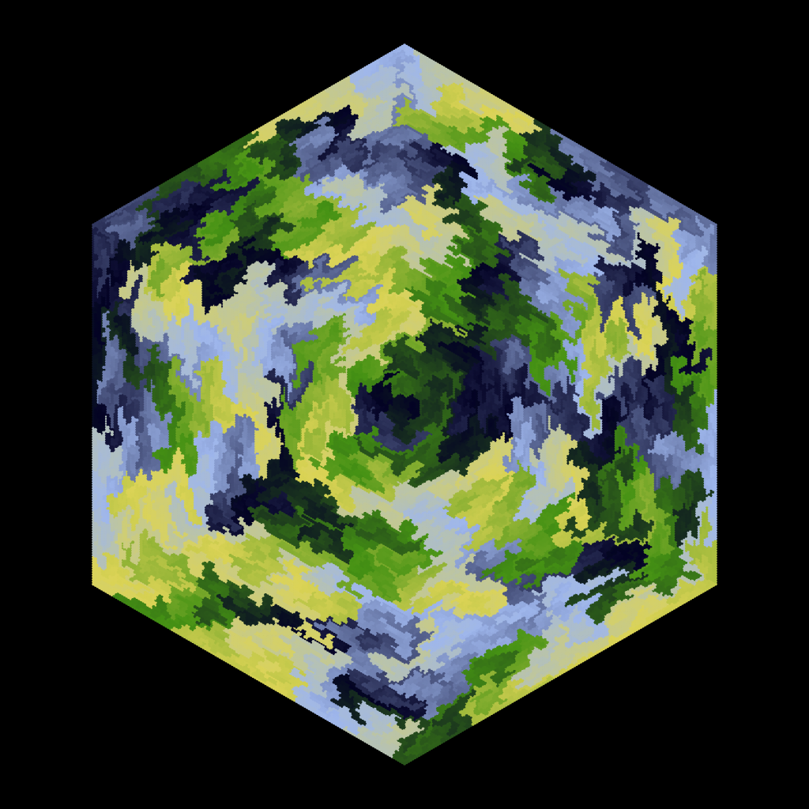
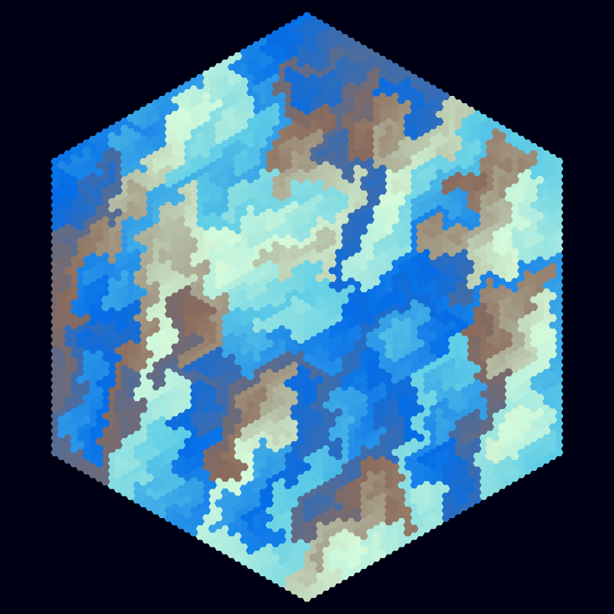
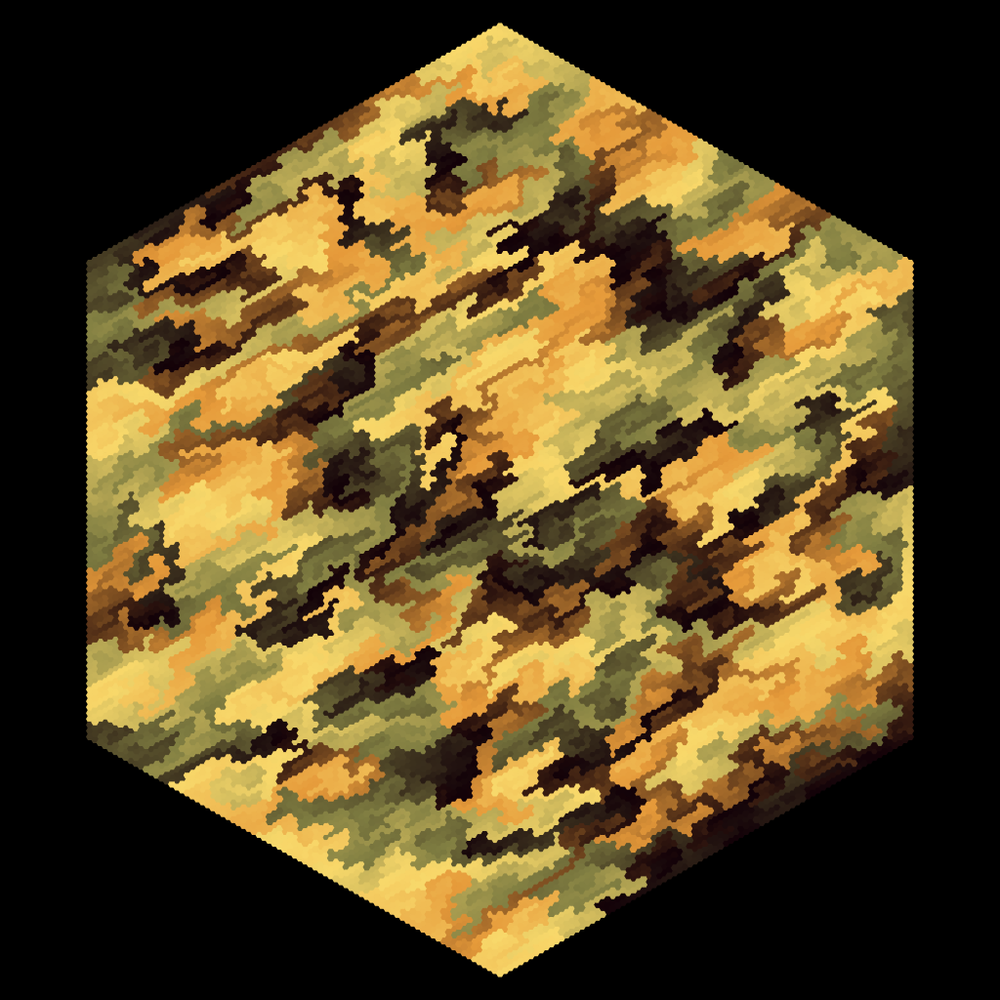
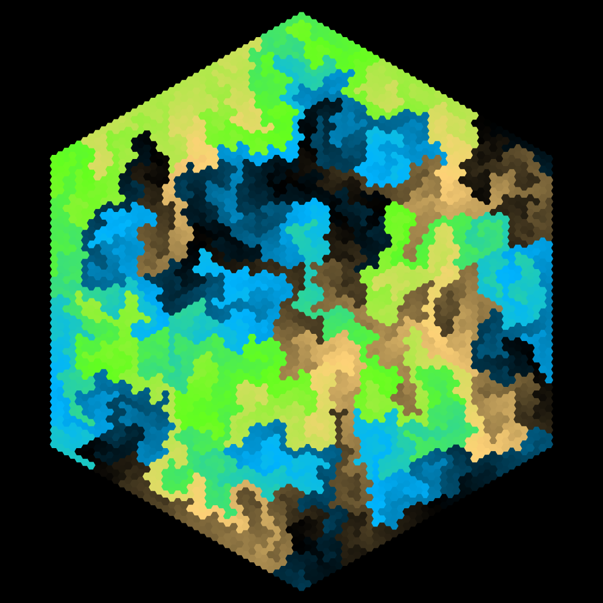
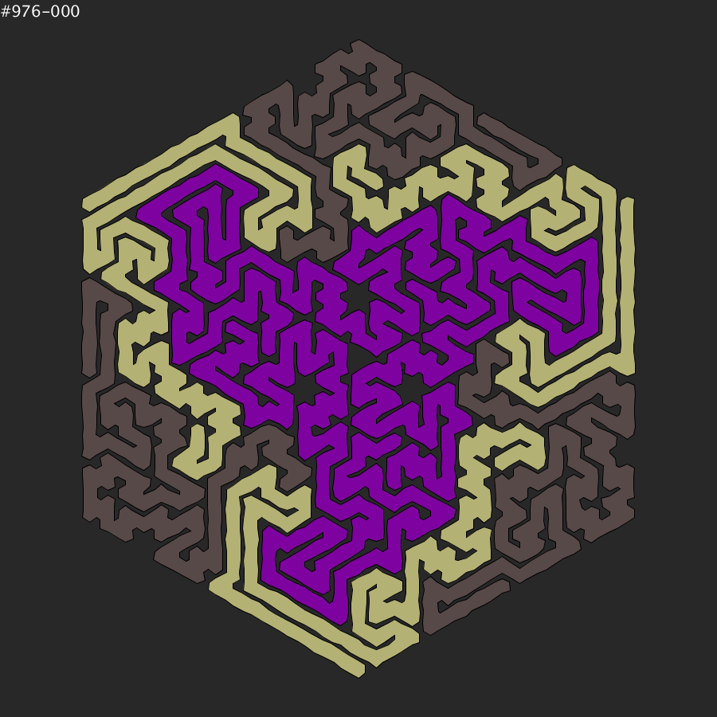
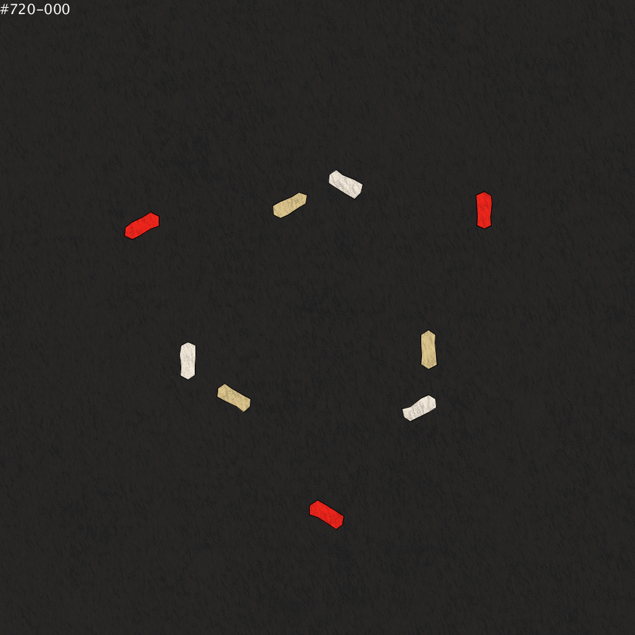
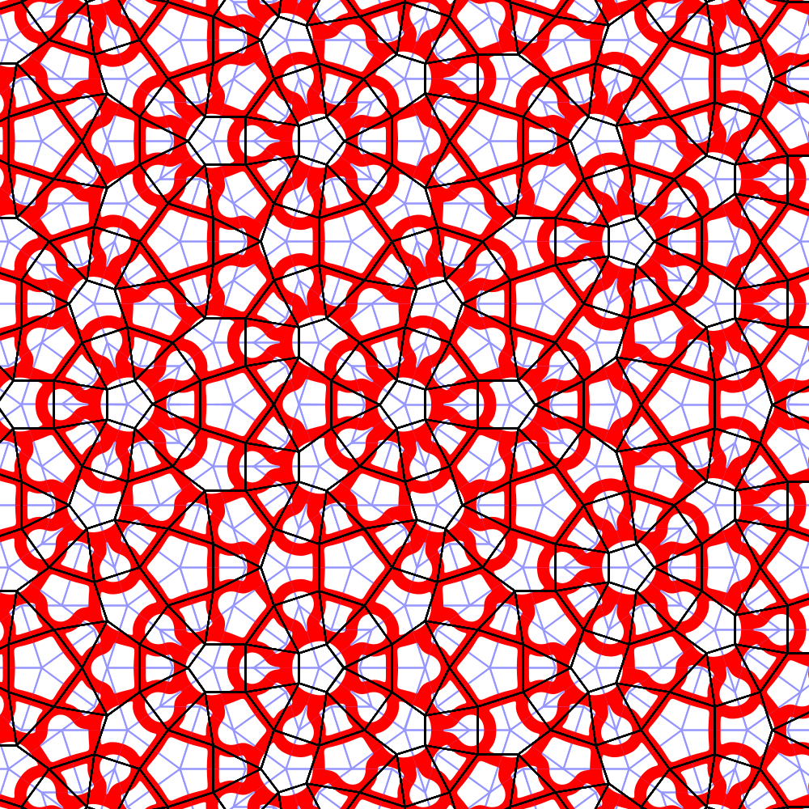
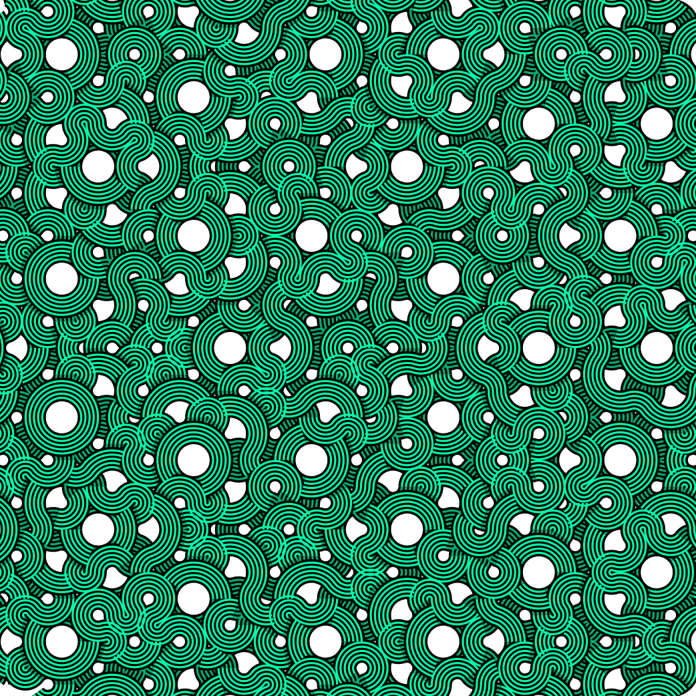

# creative-coding
Here are some of my various creative coding projects, coded in Rust or using Processing. They rely on procedural generation on hexagonal grids or generated [Penrose kite-and-dart tilings](https://en.wikipedia.org/wiki/Penrose_tiling#Kite_and_dart_tiling_(P2)). Penrose tilings are infinite, aperiodic tilings showing patterns of 5-fold symmetry, which is quite unusual in 2D tilings.

## HexFloodFill

Exploring randomized [flood fill algorithms](https://en.wikipedia.org/wiki/Flood_fill) to create colorful patterns on hexagonal grids. The choice of color variation policy makes cave-like structures appear.

## Hex pattern

Creating hexagonal patterns on a grids using floodfill as the basis for growing lines rendered procedurally.

## PenroseMaze/gen-penrose-svg (WIP)

Exploring penrose kite-and-dart tilings to create original maze-like structures. The complex aperiodicity of penrose tilings makes it impossible to represent tiles in a grid-like structure. Custom graph representations are then necessary to generate and represent tiling connexions.

Penrose tiles are intrinsically related to connected circle arcs with 2 possible radii, which allows this kind of representations.

